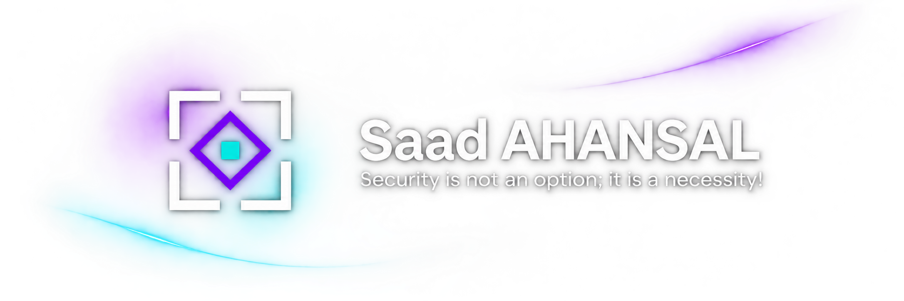

<h1 align="center">Hi 👋, I'm Saad Ahansal</h1>

<h3 align="center">IT Support | Networking | Cybersecurity</h3>

  Engineering student passionate about digital infrastructure,
  network administration, and cybersecurity.

---

### 👨‍💻 About Me

- 🎓 Engineering student in Morocco.
- 🖥️ Interested in IT support, systems administration, and networking.
- 🛡️ Developing my knowledge of cybersecurity and SOC operations.
- 🧪 Practicing through hands-on labs and troubleshooting.
- 🌱 Learning more about Linux, Windows, and network security.

### 🛠️ Tools & Technologies

- **Operating systems:** Windows, Linux, Ubuntu
- **Networking:** Cisco Packet Tracer, TCP/IP, DHCP, SSH
- **Virtualization:** VMware
- **Scripting:** PowerShell

### 🔍 Areas of Interest

- Security Operations Center (SOC)
- Network monitoring and troubleshooting
- IT support and infrastructure
- Cybersecurity labs

---

Thanks for visiting my profile!

